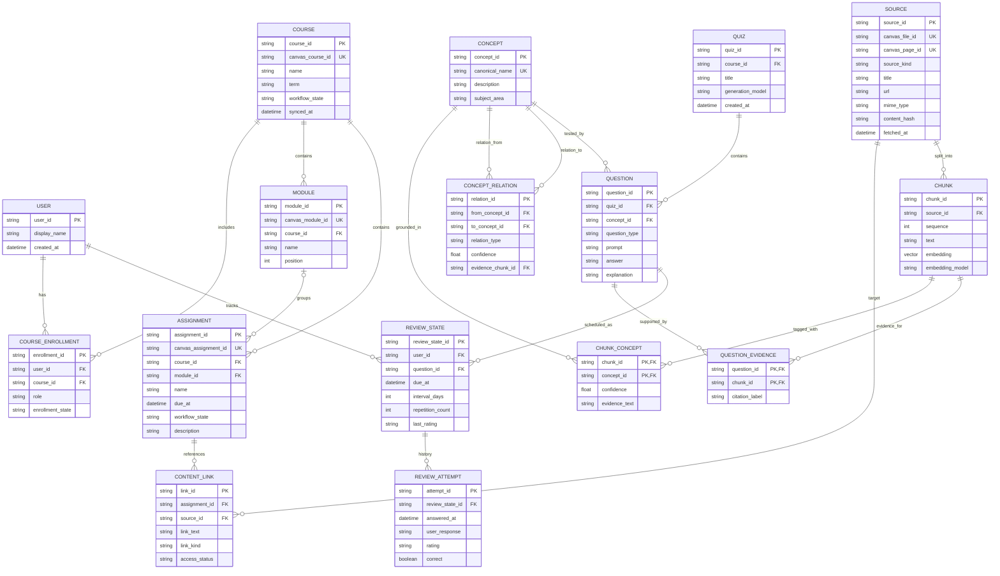

# Canvas Study Brain — Conceptual ERD

This is a logical model, not a requirement to use relational storage. It keeps Canvas identifiers and source provenance so the same domain can map to MongoDB documents or graph nodes and edges.

## Storage mappings

- **Graph database:** make `Course`, `Module`, `Assignment`, `Source`, `Chunk`, `Concept`, `Quiz`, `Question`, and `User` nodes. Turn the ERD relationships into typed edges. Store confidence and evidence references on concept edges; keep vector and full-text indexes on `Chunk` text.
- **MongoDB:** use separate collections for courses, assignments, sources, chunks, concepts, quizzes, and review state. Embed small, stable arrays such as module summaries, but reference chunks, sources, and review attempts by ID to avoid growing course documents indefinitely.
- **Common identifiers:** preserve Canvas IDs as unique external keys; store source URL, content hash, sync time, and extraction status to support safe re-syncs and citations.

## Modeling notes

- A source can be a Canvas file, Canvas page, assignment description, or public external page. `CONTENT_LINK` records where it was discovered and whether it could be fetched.
- Concepts and concept-to-concept relationships should retain evidence chunk IDs and confidence. Treat model-extracted relationships as suggestions until grounded in source text.
- Keep spaced-review scheduling deterministic in application code. `REVIEW_STATE` stores the next due time; `REVIEW_ATTEMPT` preserves the answer history.
- The `vector` field is conceptual. Choose the concrete vector representation and index based on the selected database and installed extensions.
