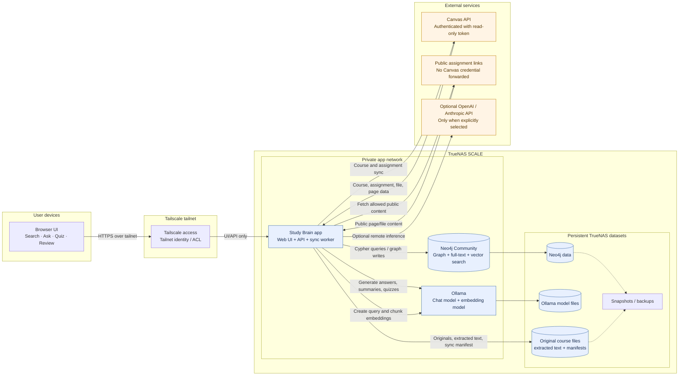

# Canvas Study Brain — System Design Mockup

Conceptual deployment for one user on a TrueNAS SCALE home NAS. The browser reaches the app over the tailnet; the database and model are private services on the NAS.

## Main request flows

1. **Sync:** the worker reads courses and assignments from Canvas, follows Canvas resources with the token, and fetches only public external links without forwarding that token. It preserves source URLs, Canvas IDs, content hashes, fetch status, and extraction metadata.
2. **Index:** extracted text is split into cited chunks. Ollama creates embeddings; the app writes source, chunk, concept, and relationship records to Neo4j. Concept edges retain evidence chunk IDs and confidence.
3. **Ask:** the app combines vector matches, full-text matches, and graph traversal to select cited context. Ollama answers from that context and returns source references to the UI.
4. **Quiz/review:** quiz questions point to evidence chunks and concepts. Review attempts and due dates are written back to Neo4j; scheduling stays deterministic in application code.

## Container and network boundaries

- Run Neo4j and Ollama with persistent TrueNAS datasets. The study app gets access to the source-files dataset; the browser does not access storage or databases directly.
- Publish only the study UI/API through Tailscale. Keep Neo4j Bolt/Browser and Ollama ports private to the app network.
- Store Canvas and optional provider credentials as server-side secrets. Do not expose them to browser code or forward the Canvas token to external-link hosts.
- The first deployment can use one Study Brain container for the UI, API, and sync worker. Split the worker out only if ingestion needs independent scheduling or resource limits.
- Optional OpenAI/Anthropic calls are disabled by default; local Ollama is the default for generation and embeddings.
